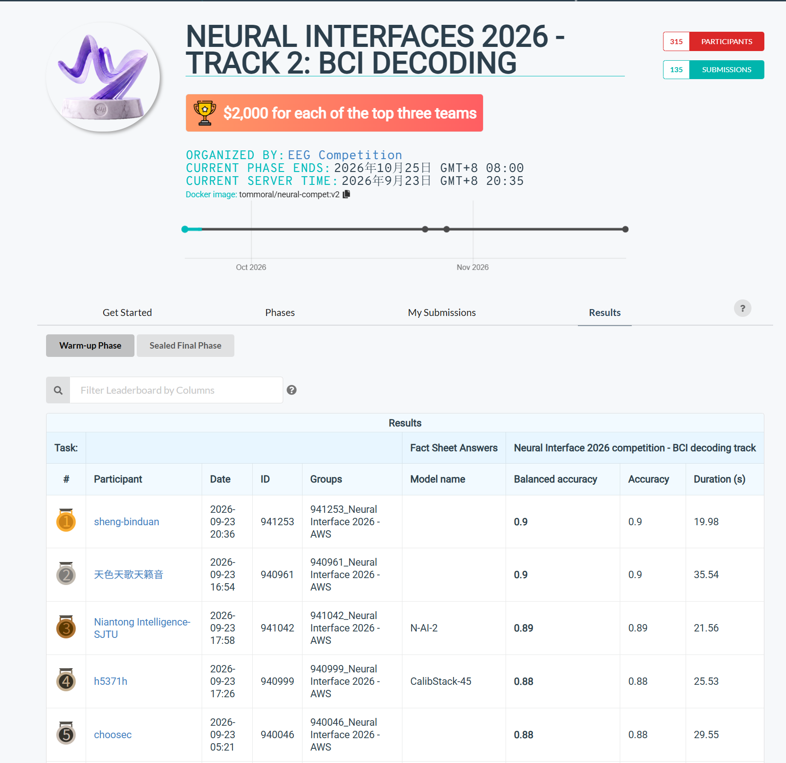

# 🧠 NeurIPS Competition 2026

This repository is created for our participation in the **NeurIPS Competition 2026**.

We are currently focusing on **Track 2: BCI Decoding**.  
The repository is used to share code, track experiments, and record our progress during the competition.

## 🏆 Warm-up Phase

Our current submission achieved a **Balanced Accuracy of 0.90** in the warm-up phase.

# 

## 📌 Status

🚧 Experiments and model improvements are still in progress.

## EEG preprocessing

The warm-up EEG preprocessing project is available in [`preprocessing/`](preprocessing/).
Its [Chinese README](preprocessing/README.md) covers installation, data placement,
manual annotations, workflow stages, cache recovery, and experiment configuration snapshots.
Use `preprocessing/run_preprocessing.py` for the staged workflow, or
`preprocessing/src/preprocessing_config_version.py` for configuration-driven experiments.
The [changelog](preprocessing/CHANGELOG.md) records the 2026-10-14 framework update.
The project includes source code, empty annotation templates, and the runtime directory skeleton;
raw data and generated artifacts are excluded from this module.
